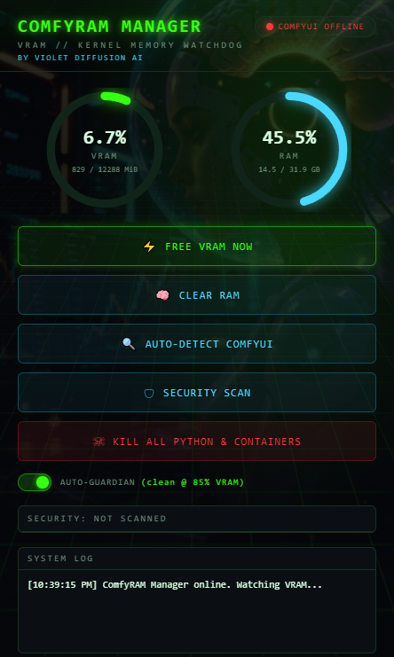

# ComfyRAM Manager

**See and free the memory ComfyUI is holding, with one key.**


ComfyUI keeps model weights in VRAM between runs on purpose. On a 12 GB card, what is still loaded from
the last image decides whether the next one fits, and nothing shows you that until a run fails. ComfyRAM
Manager is a small always-on panel that shows VRAM and system RAM, frees them on demand, and does it by
itself when VRAM gets full.

**Slides:** [docs/slides.html](docs/slides.html) · **User guide:** [docs/USER-GUIDE.md](docs/USER-GUIDE.md) ·
**Pages:** <https://violinet-tech.github.io/comfyram-manager/>

Windows only. Electron front end, PowerShell underneath. MIT licensed.



## Get it

1. Download `ComfyRAM Manager Setup 1.1.0.exe` from
   [Releases](https://github.com/Violinet-tech/comfyram-manager/releases).
2. Run it. There is nothing to configure. It finds ComfyUI by scanning for its port.

## What you get

- **Two live rings.** VRAM used out of total, and system RAM. They update every 4 seconds.
- **ComfyUI status.** Online or offline, and on which port.
- **Ctrl+Alt+F.** Frees VRAM from anywhere, without focusing the window: mid-generation, from inside ComfyUI,
  from a game.
- **Auto Guardian.** On by default. When VRAM passes **85%** it frees memory, then waits 15 seconds before it
  will do it again.
- **A system log** of everything it did, with before and after numbers.

## The buttons

| Button | What it does |
|---|---|
| **Free VRAM now** | Calls ComfyUI's own `/free` on the detected port, trims process working sets, and reloads the ComfyUI browser tab. Reports VRAM before and after. |
| **Clear RAM** | System memory only: file cache and working sets. Leaves the GPU alone. |
| **Auto-detect ComfyUI** | Re-scans for ComfyUI's port. Use it after starting or restarting ComfyUI. |
| **Security scan** | Walks running processes and checks the suspicious ones. Slower than the rest: it gets 45 seconds instead of 20. |
| **Kill all Python & containers** | **Destructive.** Ends every Python process and container it finds, including ComfyUI itself and any unsaved work in it. A last resort, not a cleanup. |

## Why Free does four things

`/free` on its own only touches what ComfyUI itself allocated, and it sets a flag on the prompt queue
instead of acting at once. Working sets, the file cache and a browser tab pinning GPU memory are outside its
reach. So Free here asks ComfyUI to unload, trims working sets, and reloads the tab, then reports the result.

## Settings

The thresholds are in the `CONFIG` object at the top of [`main.js`](main.js): `pollMs`, `vramThreshold`,
`autoGuardian`, `cooldownMs`. There is no settings screen yet. Change them there and rebuild.

## Build from source

```bash
npm install
npm start        # run it
npm run dist     # build the Windows installer
```

`scripts/**/*` must stay unpacked from the asar, because PowerShell cannot read inside a packed archive.
`asarUnpack` in `package.json` handles this.

## Layout

```
main.js                  window, polling loop, Auto Guardian, global hotkey, IPC
preload.js               the only bridge the page gets
renderer/                the panel: index.html, renderer.js, style.css
scripts/actions.ps1      runs one action and answers in JSON
scripts/GuardianCore.ps1 the work: VRAM and RAM reads, port discovery, frees
```

Context isolation is on and Node integration is off. The page reaches the system only through the few IPC
channels in `preload.js`.

## License

MIT. See [LICENSE](LICENSE).
