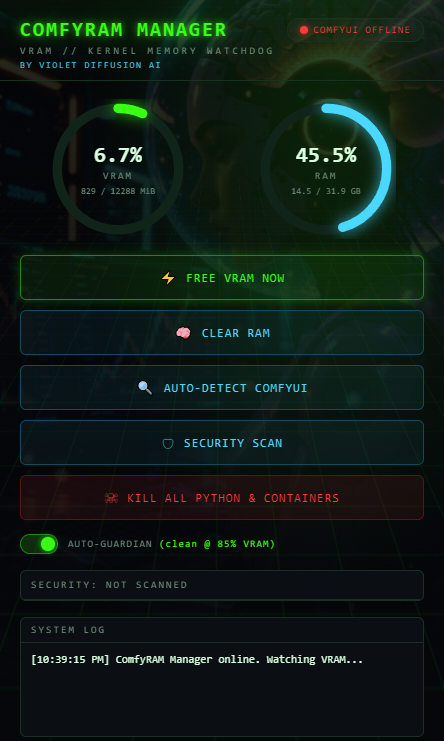

# ComfyRAM Manager user guide

ComfyRAM Manager is a small panel that shows how much memory ComfyUI is holding and frees it with a click or
a key. It works on Windows.

## 1. Install

1. Download `ComfyRAM Manager Setup 1.1.0.exe` from
   [Releases](https://github.com/Violinet-tech/comfyram-manager/releases).
2. Run it and open **ComfyRAM Manager**.

The window is 460 by 780 and does not resize.

## 2. Read the panel



| Part | Meaning |
|---|---|
| **VRAM ring** | Graphics memory in use, as a percent, with MiB used and total. |
| **RAM ring** | System memory in use, with GB used and total. |
| **COMFYUI ONLINE / OFFLINE** | Whether it found a running ComfyUI. It shows the port when online. |
| **Auto-guardian switch** | On means it frees VRAM by itself at 85%. |
| **System log** | Every action, with the time and before and after numbers. |

The panel updates every 4 seconds.

## 3. Free memory

- Press **Free VRAM now**, or use **Ctrl+Alt+F** from anywhere.
- The log shows VRAM before and after.
- If ComfyUI is running, its browser tab reloads. Save any workflow you have not saved first.

Use **Clear RAM** when system memory is the problem and the GPU is fine.

## 4. If it says COMFYUI OFFLINE

Start ComfyUI, then press **Auto-detect ComfyUI**. The panel scans for the port, so a non-standard port works.

## 5. Auto Guardian

On by default. At 85% VRAM it runs Free, then waits 15 seconds before it can run again. Use the switch to turn
it off. To change 85% or 15 seconds, edit `vramThreshold` and `cooldownMs` in `main.js` and rebuild.

## 6. Security scan

Checks running processes and flags suspicious ones. It takes up to 45 seconds. It only reports. It does not
remove anything.

## 7. Kill all Python and containers

Ends every Python process and container, including ComfyUI. Anything unsaved is lost. Use it only when
ComfyUI is frozen and nothing else works.

## Problems

| Symptom | What to do |
|---|---|
| Free did not drop VRAM much | Something other than ComfyUI holds it. Close other GPU programs, then try again. |
| The hotkey does nothing | Another app may own Ctrl+Alt+F. Close it, or use the button. |
| Offline but ComfyUI is running | Press **Auto-detect ComfyUI**. |
| The installer is flagged by Windows | The installer is not code-signed yet. Choose **More info**, then **Run anyway**, if you trust the source. |

## Build it yourself

```bash
npm install
npm run dist
```
